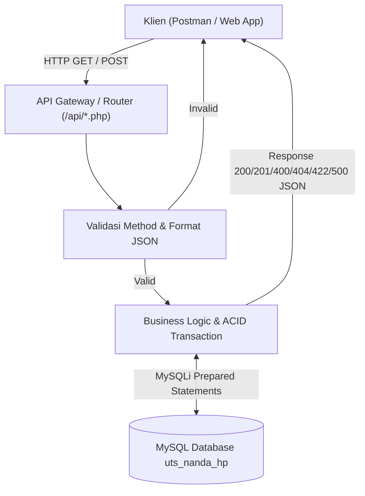

# Dokumen Rancangan Endpoint Web Service / REST API Marketplace
**Mata Kuliah**: Pemrograman Web / Pengembangan Aplikasi Web  
**Dosen Pengampu**: Pak Hary  
**Topik Tugas**: Soal 12 - Pengembangan Web Service / REST API Marketplace  
**Studi Kasus**: Marketplace "Nanda Handphone" (Smartphone & Aksesoris)  
**Teknologi**: PHP Native 8.x, MySQLi, JSON, HTTP Status Code Standar REST  

---

## 1. Pendahuluan & Latar Belakang

Sistem Marketplace "Nanda Handphone" sebelumnya telah memiliki arsitektur web berbasis antarmuka grafis (GUI) monolitik dengan PHP Native dan MySQLi. Untuk mendukung integrasi multi-platform (seperti aplikasi mobile Android/iOS, sistem kasir POS, atau layanan pihak ketiga), sistem dikembangkan lebih lanjut dengan menambahkan lapisan **Web Service / RESTful Application Programming Interface (REST API)** tanpa mengubah atau mengganggu alur sistem yang sudah berjalan.

Web Service ini mengadopsi prinsip arsitektur REST:
1. **Stateless**: Setiap permintaan membawa seluruh informasi yang diperlukan tanpa bergantung pada sesi sisi server yang tersimpan.
2. **Client-Server Architecture**: Pemisahan yang tegas antara penyedia data (backend API) dan klien pengguna (Postman / Mobile App / Frontend).
3. **Format Data Seragam (Uniform Interface)**: Menggunakan standar media type `application/json` dengan penataan struktur response yang konsisten.
4. **Standard HTTP Methods**: Memanfaatkan kata kerja HTTP standar (`GET`, `POST`, `OPTIONS`) secara semantik.

---

## 2. Standar Format Request & Response

### 2.1 HTTP Request Headers Standar
- `Accept: application/json`
- `Content-Type: application/json` (khusus untuk request dengan payload body seperti `POST`)

### 2.2 Format Response JSON Standar
Setiap endpoint API mengembalikan struktur JSON terstandarisasi sebagai berikut:

#### Format Berhasil (Success Response):
```json
{
  "status": "success",
  "code": 200,
  "message": "Pesan deskriptif keberhasilan",
  "total": 10,
  "data": { ... }
}
```

#### Format Gagal / Validasi (Error Response):
```json
{
  "status": "error",
  "code": 400,
  "message": "Deskripsi kesalahan atau alasan kegagalan",
  "errors": {
    "nama_kolom": "Pesan validasi spesifik"
  }
}
```

### 2.3 Standar HTTP Status Code yang Digunakan
| HTTP Code | Definisi Standar | Penggunaan dalam Sistem |
|:---:|:---|:---|
| **200 OK** | Permintaan berhasil diproses | Digunakan untuk response sukses `GET` data produk, kategori, dan detail |
| **201 Created** | Sumber daya baru berhasil dibuat | Digunakan saat order/pesanan baru berhasil dicatat di database |
| **400 Bad Request** | Format request tidak valid / parameter salah | Parameter ID bukan angka, payload JSON rusak, kolom wajib kosong |
| **404 Not Found** | Data / Resource tidak ditemukan | ID produk atau pesanan yang dicari tidak ada dalam tabel database |
| **405 Method Not Allowed** | Metode HTTP tidak diizinkan | Mengirim `POST` ke endpoint `produk.php`, atau `DELETE`/`PUT` |
| **422 Unprocessable Entity** | Validasi aturan bisnis gagal | Kuantitas pesanan melebihi sisa stok yang tersedia di database |
| **500 Internal Server Error** | Kesalahan server / database | MySQL mati, kegagalan transaksi query, sintaks SQL gagal |

---

## 3. Matriks Rancangan Endpoint API

| No | Endpoint URI | HTTP Method | Fungsi / Deskripsi | Parameter / Body | HTTP Status Code |
|:---:|:---|:---:|:---|:---|:---:|
| 1 | `/api/produk.php` | `GET` | Mengambil seluruh katalog produk | `?kategori=`, `?q=`, `?kondisi=` (opsional) | `200 OK`, `500` |
| 2 | `/api/produk.php?id={id}` | `GET` | Mengambil detail 1 produk spesifik | `id` (integer query string, wajib) | `200 OK`, `400`, `404`, `500` |
| 3 | `/api/kategori.php` | `GET` | Mengambil daftar seluruh kategori | `?id=` atau `?slug=` (opsional) | `200 OK`, `404`, `500` |
| 4 | `/api/pesanan.php` | `POST` | Membuat transaksi pesanan (Checkout) | JSON Body (`nama_pembeli`, `items`, dll.) | `201 Created`, `400`, `404`, `422`, `500` |
| 5 | `/api/pesanan.php?kode={kode}` | `GET` | Melacak status pesanan (Bonus) | `kode` (string invoice) atau `id` (int) | `200 OK`, `400`, `404`, `405` |
| 6 | `/api/index.php` | `GET` | Metadata & dokumentasi API service | - | `200 OK` |

---

## 4. Rincian Spesifikasi Setiap Endpoint



---

### 4.1 Endpoint 1: GET `/api/produk.php`
- **Tujuan**: Menampilkan seluruh katalog barang smartphone dan aksesoris yang ada di database.
- **Metode**: `GET`
- **URL Lengkap**: `http://localhost/utspakhary/api/produk.php`
- **Query Parameter (Opsional)**:
  - `kategori`: ID atau Slug kategori (contoh: `?kategori=1` atau `?kategori=android`)
  - `q`: Kata kunci pencarian nama barang atau merk (contoh: `?q=samsung`)
  - `kondisi`: Filter `Baru` atau `Bekas`
- **Response Berhasil (Status 200 OK)**:
```json
{
  "status": "success",
  "code": 200,
  "message": "Daftar produk berhasil diambil.",
  "total": 10,
  "data": [
    {
      "id_produk": 1,
      "nama_produk": "Samsung Galaxy A55 5G (8GB/256GB)",
      "merk": "Samsung",
      "harga": 5799000,
      "harga_format": "Rp 5.799.000",
      "stok": 15,
      "kondisi": "Baru",
      "garansi": "1 Tahun Resmi SEIN",
      "deskripsi": "Samsung Galaxy A55 5G hadir dengan layar Super AMOLED...",
      "kategori": {
        "id_kategori": 1,
        "nama_kategori": "Smartphone Android",
        "slug": "android"
      },
      "penjual": {
        "id_penjual": null,
        "nama_penjual": "Nanda Handphone Official"
      },
      "gambar": "prod_1794155540_6af0a4140f895.jpg",
      "url_gambar": "http://localhost/utspakhary/assets/uploads/prod_1794155540_6af0a4140f895.jpg",
      "created_at": "2026-11-08 22:42:05"
    }
  ]
}
```

---

### 4.2 Endpoint 2: GET `/api/produk.php?id={id}`
- **Tujuan**: Mengambil detail lengkap 1 unit produk berdasarkan primary key ID.
- **Metode**: `GET`
- **URL Lengkap**: `http://localhost/utspakhary/api/produk.php?id=1`
- **Query Parameter (Wajib)**: `id` (integer)
- **Response Berhasil (Status 200 OK)**:
```json
{
  "status": "success",
  "code": 200,
  "message": "Detail produk berhasil diambil.",
  "data": {
    "id_produk": 1,
    "nama_produk": "Samsung Galaxy A55 5G (8GB/256GB)",
    "merk": "Samsung",
    "harga": 5799000,
    "harga_format": "Rp 5.799.000",
    "stok": 15,
    "kondisi": "Baru",
    "garansi": "1 Tahun Resmi SEIN",
    "deskripsi": "Samsung Galaxy A55 5G hadir dengan layar Super AMOLED 120Hz...",
    "kategori": {
      "id_kategori": 1,
      "nama_kategori": "Smartphone Android",
      "slug": "android"
    },
    "penjual": {
      "id_penjual": null,
      "nama_penjual": "Nanda Handphone Official"
    },
    "gambar": "prod_1794155540_6af0a4140f895.jpg",
    "url_gambar": "http://localhost/utspakhary/assets/uploads/prod_1794155540_6af0a4140f895.jpg",
    "created_at": "2026-11-08 22:42:05"
  }
}
```
- **Response Jika Data Tidak Ditemukan (Status 404 Not Found)**:
```json
{
  "status": "error",
  "code": 404,
  "message": "Produk dengan ID 9999 tidak ditemukan.",
  "data": null
}
```
- **Response Jika Format ID Salah (Status 400 Bad Request)**:
```json
{
  "status": "error",
  "code": 400,
  "message": "Parameter ID produk tidak valid. Harus berupa bilangan bulat positif (contoh: ?id=1)."
}
```

---

### 4.3 Endpoint 3: GET `/api/kategori.php`
- **Tujuan**: Mengambil seluruh kelompok/kategori barang beserta kalkulasi agregat jumlah produk (`COUNT(produk)`).
- **Metode**: `GET`
- **URL Lengkap**: `http://localhost/utspakhary/api/kategori.php`
- **Response Berhasil (Status 200 OK)**:
```json
{
  "status": "success",
  "code": 200,
  "message": "Daftar kategori berhasil diambil.",
  "total": 4,
  "data": [
    {
      "id_kategori": 1,
      "nama_kategori": "Smartphone Android",
      "slug": "android",
      "deskripsi": "Koleksi smartphone sistem operasi Android dari brand ternama seperti Samsung, Xiaomi, Vivo, Oppo, Infinix",
      "total_produk": 5
    },
    {
      "id_kategori": 2,
      "nama_kategori": "Apple iPhone (iOS)",
      "slug": "iphone",
      "deskripsi": "iPhone resmi iBox & internasional garansi terjamin dengan performa iOS prima",
      "total_produk": 1
    },
    {
      "id_kategori": 3,
      "nama_kategori": "Handphone Second Bergaransi",
      "slug": "second",
      "deskripsi": "Handphone bekas berkualitas tinggi, fungsi 100% normal dan bergaransi toko 1 bulan",
      "total_produk": 1
    },
    {
      "id_kategori": 4,
      "nama_kategori": "Aksesoris & Gadget",
      "slug": "aksesoris",
      "deskripsi": "Charger original, kabel data type-C, TWS earphone, tempered glass, dan casing pelindung",
      "total_produk": 3
    }
  ]
}
```

---

### 4.4 Endpoint 4: POST `/api/pesanan.php`
- **Tujuan**: Menerima data transaksi pemesanan barang baru, memvalidasi input, memotong stok barang secara otomatis, dan menyimpannya dalam transaksi database berintegritas tinggi (ACID).
- **Metode**: `POST`
- **Header**: `Content-Type: application/json`
- **URL Lengkap**: `http://localhost/utspakhary/api/pesanan.php`

#### Contoh Request Body (JSON):
```json
{
  "nama_pembeli": "Muhammad Nanda",
  "no_hp": "081234567890",
  "alamat_pengiriman": "Jl. Pemuda No. 45, Semarang Tengah",
  "metode_pembayaran": "Transfer Bank BCA",
  "catatan": "Mohon dipacking bubble wrap tebal warna hitam ya",
  "items": [
    {
      "id_produk": 1,
      "jumlah": 1
    },
    {
      "id_produk": 7,
      "jumlah": 2
    }
  ]
}
```

#### Response Sukses (Status 201 Created):
```json
{
  "status": "success",
  "code": 201,
  "message": "Pesanan baru berhasil dibuat dan stok produk telah diperbarui.",
  "data": {
    "id_pesanan": 6,
    "kode_pesanan": "NHP-20261116-30A7",
    "tanggal_pesanan": "2026-11-16 20:03:05",
    "nama_pembeli": "Muhammad Nanda",
    "no_hp": "081234567890",
    "alamat_pengiriman": "Jl. Pemuda No. 45, Semarang Tengah",
    "metode_pembayaran": "Transfer Bank BCA",
    "catatan": "Mohon dipacking bubble wrap tebal warna hitam ya",
    "status_pesanan": "Menunggu Konfirmasi",
    "total_pembayaran": 6089000,
    "total_pembayaran_format": "Rp 6.089.000",
    "items": [
      {
        "id_produk": 1,
        "nama_produk": "Samsung Galaxy A55 5G (8GB/256GB)",
        "merk": "Samsung",
        "harga_satuan": 5799000,
        "harga_satuan_format": "Rp 5.799.000",
        "jumlah": 1,
        "subtotal": 5799000,
        "subtotal_format": "Rp 5.799.000",
        "sisa_stok": 14
      },
      {
        "id_produk": 7,
        "nama_produk": "Adaptor Fast Charger 33W Original Type-C",
        "merk": "Baseus",
        "harga_satuan": 145000,
        "harga_satuan_format": "Rp 145.000",
        "jumlah": 2,
        "subtotal": 290000,
        "subtotal_format": "Rp 290.000",
        "sisa_stok": 33
      }
    ]
  }
}
```

#### Response Validasi Gagal (Status 400 Bad Request):
```json
{
  "status": "error",
  "code": 400,
  "message": "Validasi form pesanan gagal. Mohon lengkapi field yang diperlukan.",
  "errors": {
    "nama_pembeli": "Nama pembeli wajib diisi.",
    "no_hp": "Nomor HP/WhatsApp pembeli wajib diisi.",
    "alamat_pengiriman": "Alamat pengiriman lengkap wajib diisi.",
    "items": "Daftar item produk pesanan wajib diisi (minimal 1 item) dalam bentuk array."
  }
}
```

#### Response Stok Tidak Cukup (Status 422 Unprocessable Entity):
```json
{
  "status": "error",
  "code": 422,
  "message": "Stok produk 'Samsung Galaxy A55 5G (8GB/256GB)' tidak mencukupi (tersedia: 5 unit, diminta: 50 unit).",
  "id_produk": 1,
  "nama_produk": "Samsung Galaxy A55 5G (8GB/256GB)",
  "stok_tersedia": 5,
  "jumlah_diminta": 50
}
```

---

## 5. Keamanan & Mekanisme Transaksi Basis Data (ACID)

Pada endpoint `POST /api/pesanan.php`, diterapkan prinsip transaksi basis data terintegrasi:
1. **Atomicity**: Jika terjadi kegagalan pada saat menyimpan rincian pesanan atau pengurangan stok, seluruh operasi dibatalkan (`mysqli_rollback($koneksi)`) sehingga tidak terjadi pesanan fiktif tanpa rincian.
2. **Consistency**: Stok barang dikurangi secara akurat (`UPDATE produk SET stok = stok - ? WHERE id_produk = ?`) hanya setelah verifikasi ketersediaan stok berhasil.
3. **Isolation**: Menggunakan Prepared Statement (`mysqli_prepare` & `mysqli_stmt_bind_param`) untuk mencegah serangan SQL Injection dan kondisi balapan (race condition).
4. **Durability**: Setelah commit transaksi (`mysqli_commit($koneksi)`), data tersimpan permanen di media penyimpanan MySQL.
